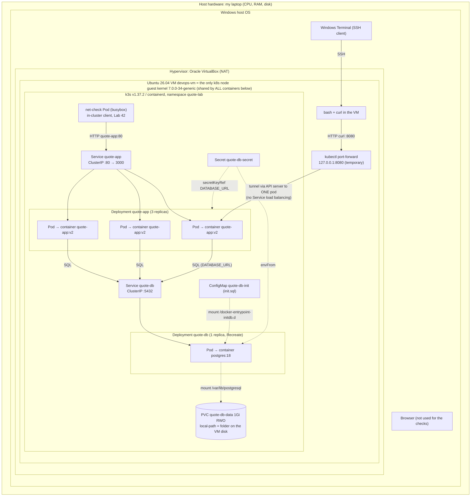

# Lab 52 – Architecture notes

Branch: `lab52`. Namespace: `quote-lab`.
Lab 42 results: [../42-kubernetes-deployment-runtime-validation/results.md](../42-kubernetes-deployment-runtime-validation/results.md)

## Environment

- Host: my laptop, Windows, Oracle VirtualBox (hypervisor, NAT network).
- VM `devops-vm`: Ubuntu 26.04.1 LTS, kernel `7.0.0-34-generic`, 2 vCPU, 3.3 GiB RAM.
- Single-node k3s `v1.37.2+k3s1`, runtime `containerd://2.3.7-k3s1`, StorageClass `local-path`.
- I recreated the VM before this lab, so I reinstalled Docker and k3s and redeployed the Lab 42 core.
- Network limit: the IUT FortiGate intercepts HTTPS to Docker Hub (`x509: certificate signed by unknown authority`).
  So I installed k3s from GitHub (airgap images) and pulled `node`, `postgres` and `busybox`
  from `public.ecr.aws/docker/library/...` (official mirror), then imported them into k3s
  with `docker save` + `k3s ctr images import`.

## Diagram (current setup)

Boxes inside boxes = **runs inside**. Solid arrows = **traffic**. Dotted arrows = config / storage.



## Database checks

Manifests: `database.yaml`, `db-init-configmap.yaml`, `init.sql` (this folder) and
`../42-kubernetes-deployment-runtime-validation/deployment.yaml` (image `quote-app:v2`, `DATABASE_URL` from the Secret).
The Secret was created with `kubectl create secret` and a random password. Only references are committed.

App code: I enabled the SELECT and INSERT queries in `labs/20-containerized-node-app/app/app.js`
and built a new image tag `quote-app:v2`.

```
$ kubectl get pvc quote-db-data
NAME            STATUS   VOLUME                                     CAPACITY   ACCESS MODES   STORAGECLASS
quote-db-data   Bound    pvc-6463023e-e164-4984-857d-97cf1326e9b6   1Gi        RWO            local-path

$ kubectl logs deployment/quote-db | tail -2
PostgreSQL init process complete; ready for start up.
... LOG:  database system is ready to accept connections
```

Quote insertion through the app (port-forward, `POST /quotes`, then `GET /`):

```
marker: res509-1794910710
$ grep -F "$quote_marker" /tmp/res509-quotes.html
    <div>res509-1794910710</div>
```

Database Pod replacement (`kubectl rollout restart deployment/quote-db`), PVC kept:

| | Before | After |
|---|---|---|
| DB Pod | `quote-db-5ff55699d6-zr7dm` | `quote-db-79448c8df-94c5m` |
| PVC | `quote-db-data` Bound, `pvc-6463023e-…` | same, Bound |
| Marker on `/` | found | found |

The app Pods kept `RESTARTS 0` during the database restart.

## Boundary notes

**Shared kernel:** the app and database containers are just isolated Linux processes
(namespaces + cgroups) on the VM, so they all share the Ubuntu VM kernel `7.0.0-34-generic`.
The real isolation boundary between my lab and the Windows host is the VM made by the
VirtualBox hypervisor; Kubernetes only manages workloads inside that VM.

**What survives what:** an app Pod can be replaced because it is stateless (Lab 42: a deleted
Pod was recreated and the Service kept working). The quote survived database Pod replacement
because the data is on the PVC, not in the container, and the new Pod mounted the same volume.
But the PVC is `local-path`, a folder on the one VM disk, and `local-path` uses reclaim policy
`Delete`: if the VM or its disk is lost (or the PVC is deleted), the data is lost too. Three app
replicas on one node do not help here. Recovery from VM or disk loss would need backups
(e.g. `pg_dump` outside the VM) or replicated storage on several nodes – future work.

## Limitations and next action

- Lab 42 readiness failure/recovery was not re-run on the new VM (results were lost when I
  recreated the VM). Next action: re-run it and add the events to the Lab 42 results.
- Access is only through a temporary `kubectl port-forward` from the VM shell.
- Images are imported by hand because of the IUT proxy (no registry in the loop).
- Single PostgreSQL Pod on a single node = single point of failure, with downtime during replacement (`Recreate`).
